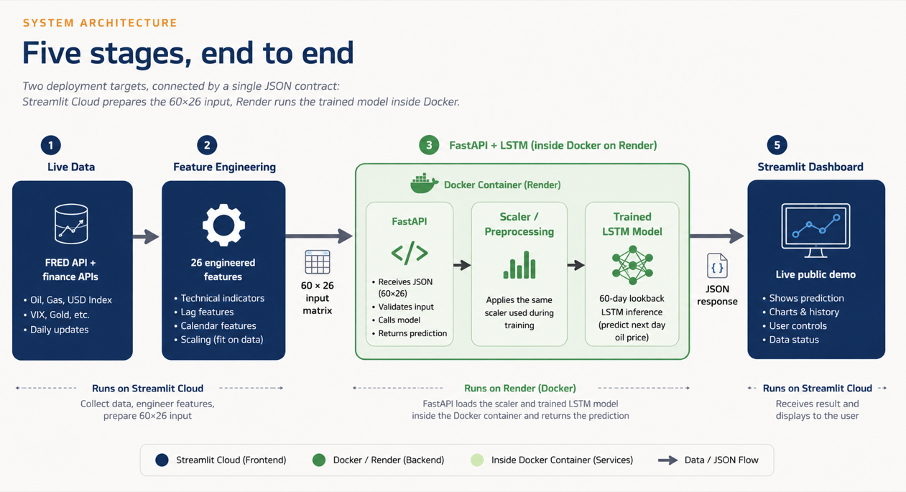
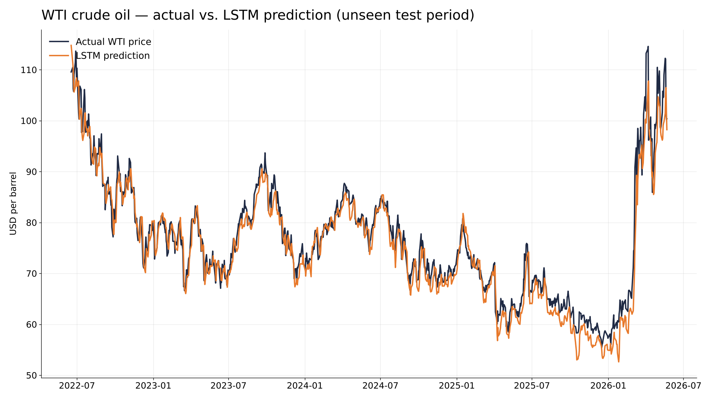

# EnergyForecast AI — Next-Day WTI Crude Oil Price Forecasting

End-to-end deep-learning system that forecasts the next-day **WTI** (West Texas Intermediate) crude oil price from live market data. It uses a stacked **LSTM** network, serves predictions through a **FastAPI** service in **Docker** on Render, and explains each forecast in plain language with **Google Gemini**.

**Live demo:** https://energy-price-prediction-ai-hzrirclu3vy9qkwvswh9gr.streamlit.app



## How it works

1. **Live data:** WTI crude, natural gas and gold from yfinance; U.S. Dollar Index and VIX from the FRED API.
2. **Feature engineering:** 5 raw series → 26 features, using the same pipeline in training and serving.
3. **Model input:** the latest 60 trading days × 26 features, Min-Max scaled with the training scaler.
4. **Inference:** the LSTM predicts the next-day WTI price, served by FastAPI inside Docker on Render.
5. **Explanation:** Gemini turns the forecast and its main signals into a short plain-English summary. If the LLM call fails, a safe fallback message is returned, so a prediction never breaks.
6. **Front end:** Streamlit fetches the data, builds the input, calls the API and shows the forecast.

## Data and features

- Daily data from 2006-03-30 to 2026-05-22 (4,933 trading days)
- Raw inputs: `Oil_Price`, `Natural_Gas`, `USD_Index`, `VIX`, `Gold`
- 26 engineered features:
  - Lags: oil price at 1, 5, 10 and 21 days
  - Rolling statistics: 7/21/60-day means, 7-day standard deviation
  - Log returns: oil, gas, gold, VIX
  - Momentum (7, 21 days) and volatility (21, 60 days)
  - Calendar: month, quarter, day of week
  - Cross-market: gold-to-oil ratio, VIX spike flag

## Model

| Layer | Details |
|---|---|
| Input | 60 time steps × 26 features |
| LSTM | 128 units, return sequences |
| Dropout | 0.2 |
| LSTM | 64 units |
| Dropout | 0.2 |
| Dense | 32 units, ReLU |
| Output | Dense 1 (next-day price) |

- Framework: TensorFlow / Keras
- Optimizer: Adam · Loss: MSE
- Training: chronological 80/20 split (no shuffling, no look-ahead leakage), EarlyStopping (patience 15), ReduceLROnPlateau (factor 0.5, patience 7)
- Model selection: a Transformer model was also tested; the LSTM gave clearly better results and was selected.

## Results (held-out test period)

| Metric | Value |
|---|---|
| R² | 0.928 |
| MAPE | 2.97% |
| MAE | ≈ USD 2.35 per barrel |



## Limitations and next steps

- For next-day forecasting, today's price is a very strong baseline: on the same test period, "tomorrow = today" reaches a MAPE of 1.79%.
- Next steps: predict price changes (returns) instead of price levels, report directional accuracy (up/down), and compare against the baseline and other architectures.
- Live monitoring: compare forecasts with actual prices over time to detect model and data drift.

## Tech stack

Python · TensorFlow/Keras · scikit-learn · pandas · FastAPI · Pydantic · Uvicorn · Docker · Render · Streamlit Community Cloud · yfinance · FRED API · Google Gemini API

## API endpoints

| Method | Endpoint | Purpose |
|---|---|---|
| GET | `/` | Health check |
| GET | `/features` | Lists the 26 features and the 60-day lookback |
| POST | `/predict` | Takes a 60 × 26 matrix, returns the forecast and explanation |
| GET | `/predict/latest` | Forecast from the latest prepared input file |
| GET | `/input/status` | Status of the latest prepared input |

Interactive docs: `https://oil-price-api-v2.onrender.com/docs`

## Run locally

```bash
pip install -r requirements.txt

# Environment variables
export GEMINI_API_KEY=your_gemini_key   # explanation layer
export FRED_API_KEY=your_fred_key       # USD Index and VIX data

# API
uvicorn api.app:app --host 0.0.0.0 --port 8000

# Front end (in a second terminal)
export PREDICTION_API_URL=http://localhost:8000/predict
streamlit run streamlit/streamlit_app.py
```

With Docker:

```bash
docker build -t oil-price-api .
docker run -p 8000:8000 -e GEMINI_API_KEY=your_gemini_key oil-price-api
```

## Project structure

```text
api/            FastAPI application
live_data/      Live data download, feature engineering, 60×26 input pipeline
streamlit/      Streamlit front end
models/         Trained LSTM (.keras) and fitted scaler (.pkl)
data/           Training dataset (26 features)
train.py        Model training and evaluation
predict.py      Inference logic
explain.py      Gemini explanation layer
Dockerfile      Container for the API
```

## Author

**Kai (Kourosh) Shahram** — [GitHub](https://github.com/kourshah)

*Model estimates only — not financial advice.*
